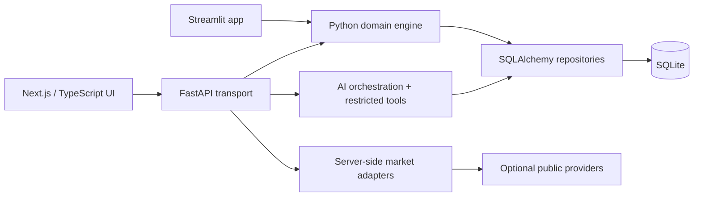

# SpendWise AI

<div align="center">

### A local-first personal finance workspace for understanding spending, cash flow and shared expenses


Original portfolio software. Payments are simulated; no bank or UPI network is connected.

</div>

> SpendWise AI combines a paise-accurate Python ledger with a typed Next.js experience. It can import statement data into a reviewable preview, explain verified aggregates, and prepare shared-expense actions that require explicit confirmation.

## Contents

- [What it does](#what-it-does)
- [Architecture](#architecture)
- [Quick start](#quick-start)
- [Core workflows](#core-workflows)
- [Testing](#testing)
- [Security and privacy](#security-and-privacy)
- [Known limitations](#known-limitations)
- [Documentation](#documentation)
- [Roadmap](#roadmap)

## What it does

| Area | Current capability |
| --- | --- |
| Ledger | Integer-paise income, expenses, refunds, transfers, adjustments and derived account balances |
| Accounts | Multiple simulated accounts with opening balances and account-scoped views |
| Imports | CSV and text-based/password-protected PDF preview, validation, provenance and duplicate protection; Jio Payments Bank parser is registered |
| Classification | Canonical categories, conservative Indian merchant rules, manual corrections, rule learning and classification history |
| Splitting | Equal/custom participant shares, contact reuse, reimbursements, reversal and idempotent preview/confirmation |
| Planning | Recurring schedules, budgets, savings goals and contributions |
| Analytics | Filtered dashboard KPIs, trends, category/merchant views, insights and reports |
| Assistant | Read-only financial tool registry with an optional OpenRouter summarizer and deterministic local fallback |
| Market modules | Server-side, attributed adapters for gold, delayed market series and news; unavailable providers fail closed |
| UI | Next.js/Tailwind mobile-first views plus the original Streamlit application preserved |

The application deliberately distinguishes gross cash movement from confirmed personal expense, reimbursement and internal transfer. Ambiguous imported payments remain reviewable instead of being silently treated as spending.

## Architecture



- `src/engine.py` is the accounting boundary. It operates on integer paise and owns payment state, ledger entries, transfers, splits, reimbursements, imports and financial metrics.
- `backend/main.py` is the FastAPI transport/application boundary. It validates request models, resolves account/date scope and translates repository data to API responses.
- `src/models.py`, `src/repositories.py`, `src/db.py` and `src/migrations.py` keep persistence separate from the engine. The current migration runner is explicit and records revisions in `schema_migrations`.
- `src/ai_intelligence.py` exposes deterministic analytics and a server-side allowlist of read-only tools. `src/ai_provider.py` optionally calls OpenRouter; it never receives direct SQL access.
- `frontend/lib/api.ts` is the typed API client. Reusable views live in `frontend/components/`; `frontend/app/page.tsx` retains the main navigation/composition structure.

See the detailed [architecture document](docs/ARCHITECTURE.md), [data pipeline](docs/DATA_PIPELINE.md), [AI workflow](docs/AI_WORKFLOW.md) and [database reference](docs/DATABASE.md).

### Verified audit checklist

- [x] FastAPI, Streamlit and Next.js entry points identified.
- [x] Integer-paise engine and account-balance derivation traced.
- [x] SQLAlchemy models, user-scoped references and migration revisions documented.
- [x] CSV/PDF preview, reconciliation, duplicate handling and confirmation boundary documented.
- [x] Categorization precedence, review state and canonical category registry documented.
- [x] Read-only AI tools, optional OpenRouter path and explicit split confirmation documented.
- [x] Market-provider boundary, caching/failure states and unavailable-data behavior documented.
- [x] Existing Python tests and frontend typecheck/lint/build executed after the documentation pass.
- [ ] Browser screenshots and browser-level QA — not claimed in this repository pass.
- [ ] Production authentication, tenant isolation and live bank connectivity — intentionally out of scope.

## Quick start

From the project root:

```bash
python3 -m venv .venv
source .venv/bin/activate
pip install -r requirements.txt
```

Create a local environment file only if one does not already exist:

```bash
cp .env.example .env
```

The backend loads the root `.env` automatically. `OPENROUTER_API_KEY` is optional; local deterministic answers and accounting do not require it. Keep the key server-side and never place it in `frontend/.env*` or a client bundle.

Start the API in one terminal:

```bash
source .venv/bin/activate
python -m uvicorn backend.main:app --reload --host 127.0.0.1 --port 8000
```

Start the web app in a second terminal:

```bash
cd frontend
npm install
npm run dev
```

Open `http://localhost:3000`. The frontend uses `http://127.0.0.1:8000/api` by default; set `NEXT_PUBLIC_API_URL` when the API is hosted elsewhere. The original app remains available with:

```bash
streamlit run app.py
```

Do not run a demo reset against a database containing personal data. The reset control is explicitly labelled for synthetic demo data.

## Core workflows

### Statement import

1. `POST /api/imports/preview` parses CSV or PDF bytes without writing ledger rows.
2. The preview reports parsed, rejected, duplicate and reconciliation information.
3. The user confirms through `POST /api/imports/{token}/confirm`.
4. Only then are normalized transactions persisted; user-scoped external references protect repeated imports.
5. Classification and analytics use the committed rows, while original narration and provenance remain available.

### Ask SpendWise AI

The assistant receives the active account/date context, selects at most one tool from the allowlist, and gets verified results from the Python analytics layer. Tool arguments are validated on the server. OpenRouter is optional and can summarize results or propose a tool; the local deterministic path remains usable when the provider is disabled, unavailable or returns an invalid response.

### Split and settle

Selected transaction IDs are retained in a session context. The server validates ownership, participant shares and integer-paise rounding, creates an editable preview, and requires an explicit confirmation before writing split records. Original bank transactions are not rewritten. Reimbursements can be matched and reversed.

### Reports and market data

Weekly/monthly reports use backend-derived aggregates and can be downloaded as a simple PDF. Gold and market requests are server-side, timeout-limited, validated and cached. A provider failure produces an unavailable state; SpendWise does not draw fake historical prices or headlines.

The current adapter boundary is:

- [GoldPrice.dev](https://goldprice.dev/) for current INR carat reference values.
- [Standard Bullion](https://standardbullion.com/gold-price-api) for historical XAU/USD observations, converted only on matching dates with [Frankfurter](https://frankfurter.dev/) USD/INR reference rates and the troy-ounce conversion.
- [TigZig TREMOR](https://www.tigzig.com/apis/tremor) for delayed market series where available.
- Google News RSS for finance headlines where available; headlines remain attributed links, not ledger data.

Provider availability and terms can change. The UI labels spot/reference/delayed data and keeps the rest of SpendWise usable when a provider is unavailable.

## Testing

Backend tests:

```bash
./.venv/bin/python -m pytest -q
```

Frontend static checks:

```bash
cd frontend
npm run typecheck
npm run lint
npm run build
```

The smoke script expects both servers to be running:

```bash
cd frontend
npm run smoke
```

The latest repository validation before this documentation pass was 87 Python tests passing, with frontend typecheck, ESLint and production build passing. Re-run the commands above after pulling changes; external market-provider availability and live browser behavior are environment-dependent.

## Security and privacy

- `.env` and `.env.*` are ignored; `.env.example` is trackable. API keys are loaded by the backend only.
- No raw PDF, PDF password, authorization header or full account number is sent to OpenRouter or written to diagnostic logs.
- The AI assistant is read-only. Financial mutations use existing explicit application endpoints and confirmation flows.
- Transaction references and repository queries are user-scoped in the data model, although the demo currently uses a single local user and does not provide production authentication.
- External market/news data is treated as untrusted, validated and isolated from core ledger calculations.
- This is a local/demo application. Do not deploy it publicly with real statements without tenant isolation, authentication, encryption, secret management and operational controls.

## Known limitations

- No real banking connectivity, UPI settlement, authentication or production multi-tenant deployment.
- The current SQLite demo database may contain legacy uncategorized rows. Backfill is explicit and reviewable; this documentation pass does not alter existing financial data.
- OpenRouter requires user opt-in, a compatible model and provider quota. Without it, local deterministic tools remain the source of numerical answers.
- Market modules depend on provider availability, attribution terms and delayed/reference data. Current values are not investment advice. Historical gold conversion only uses matching-date observations; unsupported gaps are not interpolated.
- PDF support is statement-layout dependent. A PDF can be text-based and still require bank-specific parsing or manual review; scanned-image OCR is not promised.
- No real screenshot gallery is committed yet. See the [capture checklist](docs/screenshots/README.md) for safe synthetic-data screenshots.

## Documentation

- [Architecture](docs/ARCHITECTURE.md) — boundaries, routes and design decisions.
- [Data pipeline](docs/DATA_PIPELINE.md) — imports, validation, dedupe and ledger flow.
- [AI workflow](docs/AI_WORKFLOW.md) — categorization, tools, assistant and split confirmation.
- [Database](docs/DATABASE.md) — SQLAlchemy models, migration history and relationships.
- [Screenshot checklist](docs/screenshots/README.md) — portfolio capture plan without real financial data.
- [Project blueprint](PROJECT.md) — original engineering requirements.

## Roadmap

1. Add production authentication and stronger tenant boundaries.
2. Move the explicit migration seam to a fully managed Alembic/PostgreSQL deployment.
3. Add OCR only behind a clearly labelled, local/private processing path.
4. Expand provider health/observability without logging sensitive data.
5. Add browser-level accessibility and responsive regression coverage using synthetic fixtures.

## License and portfolio note

This repository is an interview/portfolio prototype. It uses synthetic examples in documentation and should not be treated as financial advice or a production banking system.
