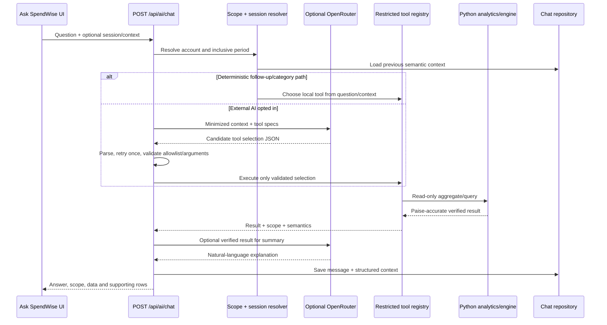
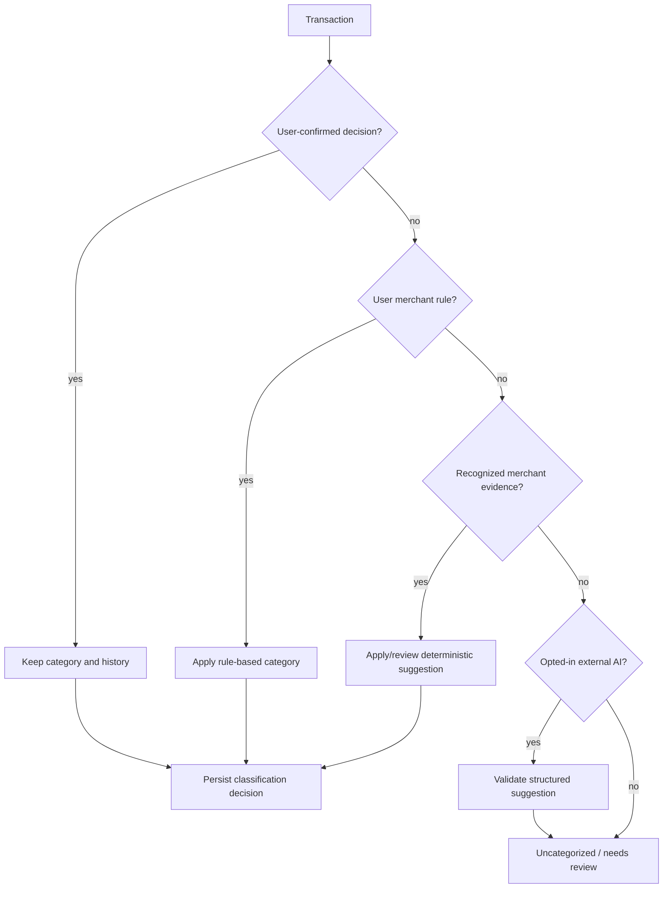
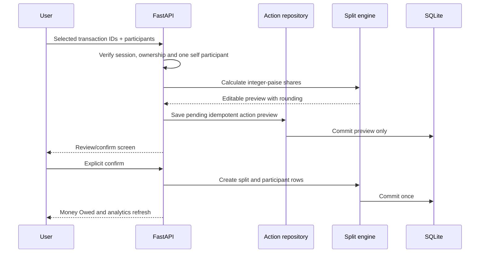

# AI and financial intelligence workflow

SpendWise uses AI as an optional interpretation layer over verified local calculations. The ledger and analytics engine remain authoritative.

## Conversational request sequence

## Restricted tool registry

The allowlisted tools in `src.ai_intelligence.TOOL_NAMES` are:

- `get_spending_summary`
- `get_category_breakdown`
- `get_merchant_breakdown`
- `get_account_comparison`
- `compare_periods`
- `get_largest_transactions`
- `get_recurring_payments`
- `get_income_summary`
- `get_cash_flow_summary`
- `get_transactions`

The server validates tool name, argument keys, date formats, account ownership, category aliases, direction, transaction type, pagination limits and the inclusive date range. The model cannot execute SQL, call arbitrary Python, or mutate the ledger.

## Local fallback

When external AI is disabled, unconfigured, rate-limited, forbidden, timed out or returns an invalid response, `restricted_chat_answer` and the same tool executor answer locally. This is not a fake answer: the numbers still come from engine/analytics results. The response indicates that local fallback was used and may include a sanitized provider diagnostic.

Provider responses can be plain JSON, fenced JSON, function-call shaped JSON or JSON surrounded by reasoning text. The parser extracts candidate objects, validates the schema and retries once with a simpler exact-schema prompt. Invalid selections never reach an executor.

## Categorization precedence

`src.categories.py` is the canonical category/alias registry. `src.engine.py` normalizes Indian UPI/gateway narrations and applies conservative merchant rules. A personal name or unclear UPI identifier alone is not enough to guess Food, Shopping or another category. Classification decisions carry category, source, confidence and confirmation state; historical decisions are retained.

## Split-action safety

The original transaction is left intact. Contact creation is normalized and user-scoped; repeated confirmation uses the action idempotency key and does not create duplicate split records.

## Reports and insights

`insight_analysis`, `build_report` and financial tools all receive the same account/date scope. Reports contain backend-derived totals, period metadata and generation timestamps. AI may explain the result but cannot add unsupported amounts or claims. Feedback is stored separately from financial records.

## External data handling

OpenRouter is opt-in and server-side. The provider receives only the minimum structured context required for tool selection or summarization; full account numbers, raw PDFs and passwords are excluded. Market/news adapters are independent of this path. Provider errors are classified without logging authorization headers, keys or full transaction payloads.
