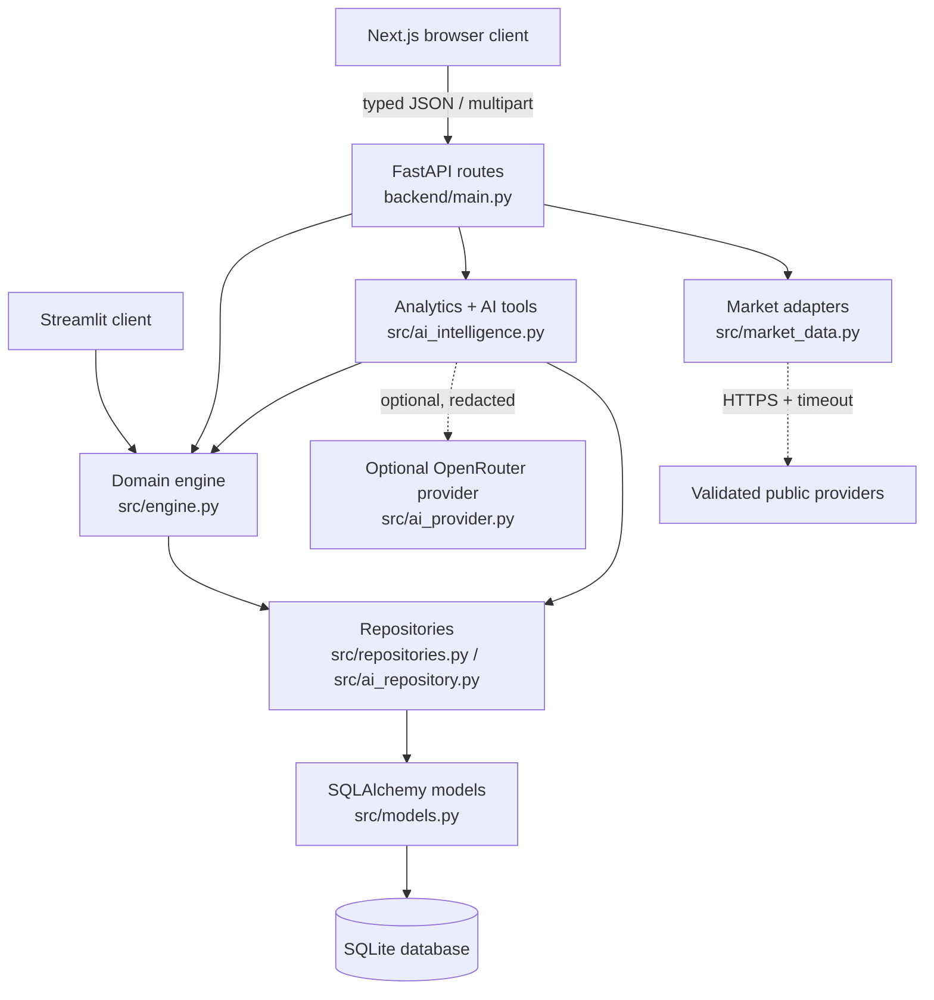
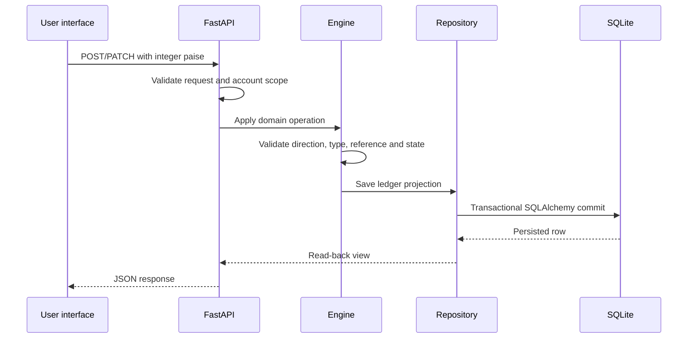

# SpendWise AI architecture

This document describes the implementation currently in the repository. It is intentionally narrower than `PROJECT.md`: it records what is wired today, not every future requirement in the original blueprint.

## System boundary



### Responsibilities

| Layer | Location | Responsibility |
| --- | --- | --- |
| Presentation | `frontend/app/`, `frontend/components/` | Navigation, forms, filters, charts, loading/error states and explicit confirmation UX |
| API client | `frontend/lib/api.ts` | Typed fetch calls and API response shapes; no accounting calculations |
| Transport | `backend/main.py` | Pydantic request validation, scope resolution, endpoint orchestration and serialization |
| Domain | `src/engine.py` | Paise arithmetic, state transitions, ledger creation, transfers, splits, reimbursements, imports and metrics |
| Intelligence | `src/ai_intelligence.py` | Canonical category resolution, deterministic classification, insights, reports and read-only tool execution |
| External AI | `src/ai_provider.py` | Optional OpenRouter requests, response parsing, retries and sanitized provider diagnostics |
| Persistence | `src/db.py`, `src/models.py`, `src/repositories.py` | SQLAlchemy sessions/models and user-scoped persistence |
| Schema | `src/migrations.py` | Explicit numbered SQLite-compatible migrations |
| Market data | `src/market_data.py` | Server-side provider adapters, validation, caching and failure isolation |

The Streamlit app is preserved as a second presentation surface. It uses the same engine/repository concepts but is not a browser replacement for the Next.js client.

## Request paths

### Normal ledger mutation



The frontend never becomes a second accounting engine. It sends paise values and displays rupees only at the presentation boundary.

### Read-only analytics

`/api/dashboard`, `/api/accounts/{account_id}/dashboard`, `/api/transactions` and `/api/ai/insights` resolve the account/date scope first. The backend filters persisted ledger data, calls engine/analytics functions, and returns derived values. Transfers, refunds, reimbursements and uncategorized debits have distinct treatment instead of being folded into salary or personal spending by the UI.

### Market data

`GET /api/market/pulse` is intentionally outside the ledger. Provider adapters are server-side, have request timeouts and validation, and return an unavailable/error state when a source cannot be reached. External values never alter balances or analytics.

## API surface

Representative route groups in `backend/main.py`:

- Core: `/api/health`, `/api/categories`, `/api/dashboard`, `/api/accounts`, `/api/transactions`, `/api/transfers`.
- Planning: `/api/recurring`, `/api/budgets`, `/api/goals`.
- Payments and sharing: `/api/payments`, `/api/splits`, `/api/incoming`, `/api/reimbursements`.
- Imports: `/api/imports`, `/api/imports/preview`, `/api/imports/{token}/confirm`.
- Categorization: `/api/ai/categorization/review`, `/api/ai/categorization/bulk`, `/api/ai/categorization/{transaction_id}`, `/api/ai/rules`.
- Intelligence: `/api/ai/insights`, `/api/ai/recurring-candidates`, `/api/ai/chat`, `/api/ai/reports`.
- Conversational actions: `/api/ai/chat/transactions`, `/api/ai/chat/selection`, `/api/ai/actions/split/preview`, `/api/ai/actions/confirm`, `/api/ai/actions/cancel`.
- Synthetic demo control: `/api/demo/reset`, guarded by an explicit request flag and intended only for demo data.

The route file is the source of truth for request models and exact response shapes.

## Design decisions

1. **Integer paise at the domain boundary.** `src.engine.paise` converts input once; totals, allocations and balances use integers. `src.engine.rupees` is for display text only.
2. **Ledger before intelligence.** Categorization and AI explain data; they do not change amounts, dates, references or running balances. Mutations use explicit existing domain operations.
3. **Preview before commit.** Statement imports and conversational splits use preview tokens/action records. Confirmation is a separate request.
4. **Scoped idempotency.** External references are unique per user, recurring postings are unique per schedule/due date, and chat actions carry a user/session/idempotency key.
5. **Conservative classification.** Deterministic rules and user corrections take precedence. Personal-looking narrations without evidence remain uncategorized or reviewable.
6. **Provider optionality.** OpenRouter improves tool selection/summaries only when opt-in, key and provider access are available. Local tools remain authoritative for numbers and usable without a key.
7. **Explicit market isolation.** Market/news failures cannot block core finance workflows or fabricate values.

## Runtime configuration

The backend calls `load_dotenv` for the project-root `.env` before creating the FastAPI app. The safe template is `.env.example`:

```text
SPENDWISE_AI_EXTERNAL_OPT_IN=true
SPENDWISE_AI_MODEL=<optional-server-side-model-id>
OPENROUTER_API_KEY=<optional-server-side-key>
```

The repository ignores `.env` and `.env.*` while explicitly allowing `.env.example`. Never commit a key, bank statement, password or local SQLite file.
