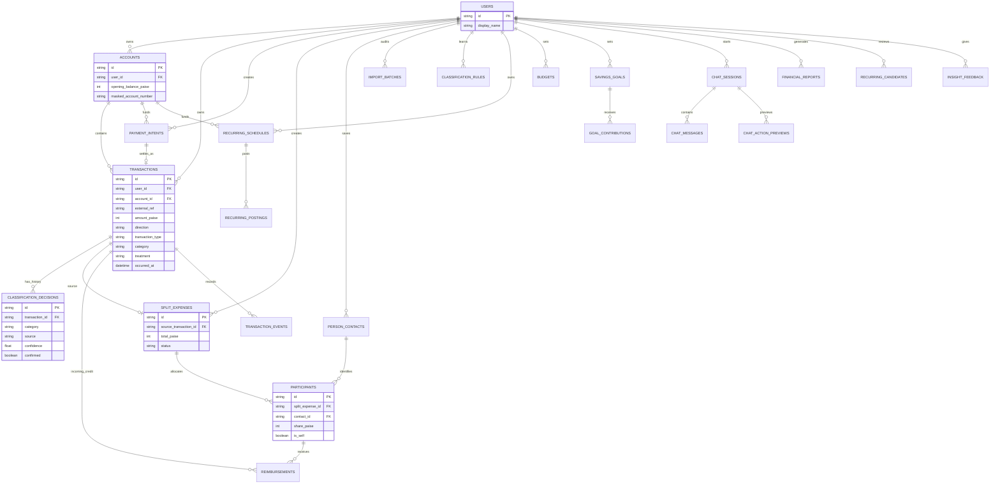

# Database and persistence reference

SpendWise currently uses SQLite through SQLAlchemy 2.x. The application keeps the domain engine separate from storage: repositories translate between engine dictionaries and ORM rows, while `src/models.py` contains storage concerns only.

## Migration runner

`src/migrations.py` creates `schema_migrations` and applies each numbered revision once. The current revision is 9:

| Revision | Schema change |
| ---: | --- |
| 1 | Core users, payment intents, transactions, classifications, splits, participants, reimbursements and import batches |
| 2 | Classification rules and transaction event audit tables |
| 3 | User-scoped transaction external-reference uniqueness |
| 4 | Accounts, recurring schedules/postings, budgets and savings goals/contributions |
| 5 | Account and transaction-type metadata on historical ledger tables |
| 6 | Repair imported transaction treatment/type metadata in place |
| 7 | AI feedback, chat, reports, recurring candidates and merchant projection |
| 8 | Chat action preview/idempotency records |
| 9 | User-scoped person contacts and participant contact links |

Migrations are additive or in-place repairs. They do not reset the SQLite file. The explicit runner is a deliberate seam for a future Alembic/PostgreSQL deployment.

## Relationship model



## Important constraints

- `transactions` has a partial unique index on `(user_id, external_ref)` when the reference is non-null. The same reference can therefore exist for different users but not twice for one user.
- `payment_intents.intent_id`, `split_expenses.source_transaction_id`, `recurring_postings.transaction_id` and other declared unique keys protect one-to-one/idempotent relationships.
- `person_contacts` is unique on `(user_id, normalized_name)` so conversational contact creation cannot silently duplicate a name inside one user's scope.
- `classification_decisions` is intentionally history, not a single mutable classification row. The current transaction projection can change while prior decisions remain auditable.
- Account balances are derived from opening balance plus posted ledger entries. There is no independent mutable current-balance source in the model.
- Amount columns are integer paise (`Integer`), never floating-point rupees.

## Current demo scope

The API currently uses a fixed demo user identifier and does not implement production authentication. User foreign keys, scoped indexes and repository checks make the storage model safer to extend, but they do not replace an authentication/authorization layer. Do not expose the local database or deploy this demo with real financial data.

## Data retention

Import batches retain sanitized audit counts/errors, not raw uploaded statement bytes. Chat sessions retain conversation context/messages needed for follow-ups. API-key values, PDF passwords and raw provider authorization headers are not model fields.

## Inspecting a local database safely

Read-only inspection examples:

```bash
sqlite3 spendwise.db ".tables"
sqlite3 spendwise.db "select revision, applied_at from schema_migrations order by revision;"
```

Use an isolated temporary database for mutation tests. Never run reset/seed commands against a personal database just to inspect schema.
