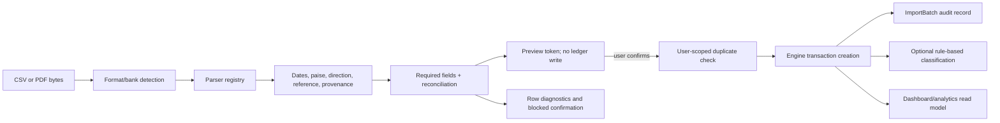

# Statement and ledger data pipeline

SpendWise treats imported statements as untrusted input. Parsing is separate from confirmation, and invalid rows are reported rather than silently converted into ledger entries.

## Import lifecycle

## CSV path

`src.statement_imports.parse_csv_statement` accepts the canonical statement columns used by the application. It validates:

- a usable date;
- a non-empty recipient/description;
- an amount that parses to integer paise;
- a valid reference where supplied;
- a debit/credit direction that is not ambiguous.

The backend returns row-level errors, duplicate counts and import-batch information. A repeated import of the same user-scoped reference is skipped as a duplicate; malformed rows are rejected and remain visible in the audit rather than being dropped.

## PDF path

`src.statement_imports.parse_pdf_statement` handles password input in memory and dispatches bank-specific layouts through the parser registry. The Jio Payments Bank parser uses page-position fragments, date boundaries, narration continuation and withdrawal/deposit/balance columns. It excludes headers, footers, summary/total rows and informational pages where the layout allows it. Reconciliation is based on extracted statement values; the parser does not hardcode a particular statement's totals.

The current contract is text-based PDFs, including password-protected files where the supplied password succeeds. Scanned-image OCR and arbitrary bank layouts are not promised. When a parser cannot establish a complete row or reconcile the statement, confirmation remains blocked and the preview reports the page/row diagnostics.

## Normalization rules

| Input concept | Stored representation |
| --- | --- |
| Rupees | Integer `amount_paise`; `₹1,199.99` becomes `119999` |
| Date | ISO date/datetime at the engine boundary |
| Debit | `direction=debit`; treatment depends on transaction intent/classification |
| Credit | `direction=credit`; not automatically salary |
| Own-account transfer | Paired transfer entries sharing `transfer_group_id` |
| Original text | `recipient`/raw narration and source/provenance fields are preserved |
| Bank reference | `external_ref`, unique per user when present |
| Running balance | Parser validation metadata; account balance is derived from opening balance plus posted ledger entries |

Refunds, reimbursements and transfers are not silently folded into personal spending. The Python engine is responsible for the final treatment and metrics.

## Confirmation and idempotency

The preview endpoint creates an in-memory/short-lived token payload rather than a transaction. Confirmation re-validates the token, account scope and selected corrections before calling the engine. The persistence layer enforces user-scoped external-reference uniqueness, while the engine also checks references for manual/imported creation. A second confirmation cannot create duplicate rows.

`ImportBatch` records filename, row count, added/skipped/error counts and sanitized row errors. It is an audit trail, not a raw-statement archive.

## Post-import classification

Committed rows may be processed by the local categorization workflow. The canonical registry in `src/categories.py` maps aliases such as Food, Dining and Restaurants to `Food / Dining`, while retaining distinct `Transport` and `Travel` categories. Merchant recognition is conservative: UPI references and gateway fragments are normalized separately from the original narration, and a personal name alone is not evidence of a category.

Classification decisions are append-only history in persistence. Manual/user-confirmed decisions take precedence over automated suggestions. Existing data is not silently backfilled by documentation or startup.

## Reconciliation

For a bank statement, the preview can expose:

- extracted row count and debit/credit counts;
- withdrawal and deposit totals in paise;
- opening and closing balances;
- running-balance mismatches;
- incomplete/ambiguous row diagnostics;
- duplicate rows that would be skipped on confirmation.

Bulk confirmation requires a successful parser-specific reconciliation. Zero values such as `0.00` are valid monetary fields and are not treated as missing.

## Data safety notes

- Raw uploaded bytes and PDF passwords are not part of the persistent audit model.
- Diagnostics should contain page/row and missing-field information, not full account numbers or complete sensitive narration.
- The local SQLite database is ignored by Git. Use a synthetic isolated database for parser and import tests.
- The pipeline preserves existing database records; no reset/reimport is part of normal startup.
